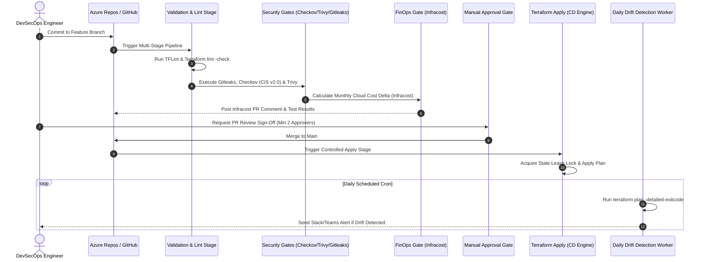

# Enterprise DevSecOps CI/CD Pipeline Templates

[](https://azure.microsoft.com/en-us/services/devops/pipelines/)
[](https://github.com/features/actions)
[](https://www.checkov.io/)
[](https://www.infracost.io/)
[](LICENSE)

A production-grade collection of modular, reusable **DevSecOps CI/CD pipeline templates** engineered for **Azure DevOps** and **GitHub Actions**. 

Incorporates enterprise **shift-left security gates**, automated linting, secret detection, policy-as-code compliance, automated cloud spend forecasting, manual deployment approval gates, and scheduled **headless infrastructure drift detection**.

---

## ⚙️ Pipeline Lifecycle Flow



---

## 📁 Repository Structure

```plaintext
devsecops-pipeline-templates/
├── pipelines/
│   └── azure-devops/
│       ├── azure-pipelines-complete.yml   # Master end-to-end multi-stage pipeline
│       └── drift-detection-schedule.yml    # Headless scheduled daily drift scanner
├── templates/
│   └── stages/
│       ├── validate-and-test.yml          # Stage 1: TFLint, format check, Gitleaks
│       ├── security-scan.yml              # Stage 2: Checkov CIS benchmarks & Trivy CVE scan
│       ├── cost-estimation.yml            # Stage 3: Infracost cloud monthly spend forecasting
│       └── terraform-apply.yml            # Stage 4 & 5: Terraform plan & gated manual apply
├── scripts/
│   ├── drift-detection.sh                 # Shell script for exitcode-based drift reporting
│   └── custom-data-bootstrap.sh           # VM compute OS hardening & middleware bootstrap
├── LICENSE                                # MIT License
└── README.md                              # Pipeline documentation & setup guide
```

---

## 🛡️ Integrated Security & Quality Toolchain

| Stage | Tooling | Purpose & Verification Gate |
| :--- | :--- | :--- |
| **Linting & Hygiene** | `tflint`, `terraform fmt` | Validates syntax, naming conventions, and Azure rules. |
| **Secret Scanning** | `gitleaks` | Detects hardcoded tokens, private keys, and passwords before commit. |
| **Policy-as-Code** | `checkov`, `tfsec` | Enforces CIS Microsoft Azure Benchmark v2.0 guardrails. |
| **Vulnerability Scanning** | `trivy` | Scans container images and filesystem configurations for CVEs. |
| **FinOps in CI** | `infracost` | Automatically generates monthly cost impact comments on pull requests. |
| **Drift Detection** | `terraform plan -detailed-exitcode` | Detects out-of-band manual portal modifications daily. |

---

## 🚀 How to Consume These Templates

### In Your Azure DevOps Pipeline:
```yaml
# In your project's azure-pipelines.yml
resources:
  repositories:
    - repository: templates
      type: github
      name: aahmad39/devsecops-pipeline-templates
      ref: refs/heads/main
      endpoint: github-service-connection

stages:
  - template: templates/stages/validate-and-test.yml@templates
  - template: templates/stages/security-scan.yml@templates
  - template: templates/stages/cost-estimation.yml@templates
  - template: templates/stages/terraform-apply.yml@templates
    parameters:
      environmentName: 'prod'
```

---

## 🤝 Author & Community

* **Author:** Adnan Ahmad ([@aahmad39](https://github.com/aahmad39))
* **Role:** Senior DevSecOps Engineer & Cloud Solutions Architect
* **Contact:** [adnanhuntp@gmail.com](mailto:adnanhuntp@gmail.com)
